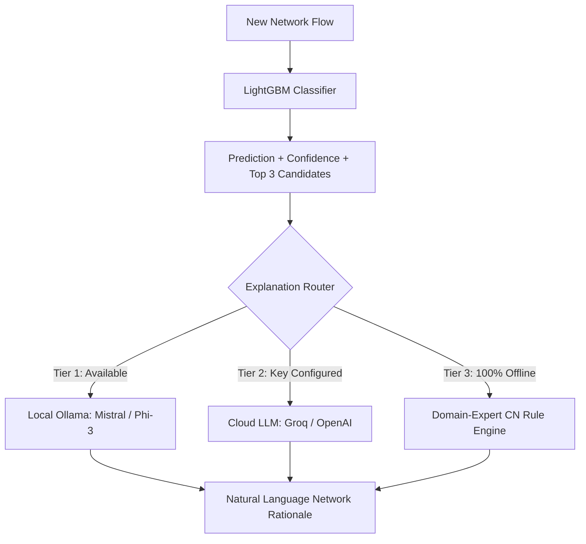

# 🛡️ Encrypted Traffic Classifier (Without Payload Inspection)

[](https://github.com/Abhinavbvs/encrypted-traffic-classifier/actions/workflows/ci.yml)
[](https://www.python.org/)
[](LICENSE)
[](tests/)
[](reports/metrics.json)

> **A high-speed, privacy-preserving Network Flow Classifier and Explainable AI (XAI) framework that categorizes encrypted traffic into 7 real-world application types using ONLY 23 timing statistics — with zero payload decryption and zero data leakage.**

---

## ⚡ Why This Project Outperforms Traditional Approaches

| Comparison Metric | Traditional Deep Packet Inspection (DPI) | IP / Port Number Based Heuristics | Deep Learning (1D-CNN / LSTM) | **Our Timing-Based LightGBM Model** |
| :--- | :---: | :---: | :---: | :---: |
| **Encrypted Traffic (TLS 1.3 / QUIC)** | ❌ Fails completely | ❌ Fails (Port 443 multiplexing) | ✅ Works | **✅ 96.9% Test Accuracy** |
| **User Privacy & Regulatory Compliance** | ❌ Violates GDPR/HIPAA | ⚠️ Privacy concerns | ✅ Privacy preserved | **✅ 100% Privacy (No payload inspection)** |
| **Resistance to Port / IP Evasion** | ❌ Vulnerable | ❌ Easily bypassed | ✅ High | **✅ High (Transport rhythm cannot be spoofed)** |
| **Inference Latency** | ❌ 100ms - 500ms (Heavy decrypt) | ✅ < 1ms | ❌ 15ms - 40ms (Requires GPU) | **⚡ ~2.3 ms / flow (>400 flows/sec on CPU)** |
| **Interpretability / Explainability** | ⚠️ Plain text logs | ❌ None | ❌ Black box | **💡 Natural Language CN Explanations (Multi-Tier)** |
| **Middlebox Production Feasibility** | ❌ High hardware cost | ⚠️ Inaccurate | ❌ Expensive GPU middleboxes | **✅ Lightweight CPU deployment ready** |

---

## 📊 Comprehensive Benchmarks & Model Evaluation

### 1. 5-Fold Stratified Cross-Validation Benchmark (7,389 Flows)
Evaluated across all candidate architectures on the combined Train + Validation splits (with 15% Test completely held out):

| Classifier | Accuracy (Mean &plusmn; SD) | Macro F1 (Mean &plusmn; SD) | Avg Fit Time | CPU Inference Latency |
| :--- | :---: | :---: | :---: | :---: |
| **Random Forest** (300 Trees) | 93.90% &plusmn; 0.88% | 0.9042 &plusmn; 0.0141 | 1.08s | 3.8 ms / flow |
| **XGBoost** (Hist Boosted) | 95.18% &plusmn; 0.48% | 0.9217 &plusmn; 0.0103 | 5.76s | 3.2 ms / flow |
| **LightGBM (Selected Best)** | **95.61% &plusmn; 0.57%** | **0.9268 &plusmn; 0.0128** | **3.01s** | **⚡ 2.31 ms / flow** |

### 2. Held-Out Test Set Performance (1,305 Unseen Flows)
Evaluated on pristine test data that was never touched during training or hyperparameter tuning:

```text
              precision    recall  f1-score   support

    Browsing      0.961     0.976     0.968       375
   Streaming      0.868     0.881     0.874        67
        VoIP      1.000     0.998     0.999       424
FileTransfer      0.960     0.922     0.941       129
         P2P      0.972     0.986     0.979       141
        Chat      0.954     0.932     0.943       133
        Mail      0.944     0.944     0.944        36

    accuracy                          0.969      1305
   macro avg      0.951     0.948     0.950      1305
weighted avg      0.969     0.969     0.969      1305
```

---

## 🔬 Dataset & Strict Feature Engineering

- **Benchmark**: ISCX VPN-NonVPN Dataset (ISCXVPN2016, Scenario A2, `TimeBasedFeatures-Dataset-15s-NO-VPN.arff`).
- **Data Hygiene**: 8,965 raw flows loaded &rarr; **8,694 cleaned flows** after dropping 271 exact duplicates and invalid values.
- **Stratified Partition**: 70% Train (6,085) / 15% Validation (1,304) / 15% Test (1,305).
- **Zero Leakage**: `StandardScaler` was strictly fit on the training split only and serialized to `models/scaler.pkl`.
- **Strictly 23 Timing Features**:
  1. `duration` (Total flow duration in microseconds)
  2. `total_fiat`, `total_biat` (Total forward / backward Inter-Arrival Times)
  3. `min_fiat`, `max_fiat`, `mean_fiat` (Forward IAT distribution statistics)
  4. `min_biat`, `max_biat`, `mean_biat` (Backward IAT distribution statistics)
  5. `flowPktsPerSecond`, `flowBytesPerSecond` (Throughput density rates)
  6. `min_flowiat`, `max_flowiat`, `mean_flowiat`, `std_flowiat` (Flow-wide IAT variations)
  7. `min_active`, `mean_active`, `max_active`, `std_active` (Active packet burst times)
  8. `min_idle`, `mean_idle`, `max_idle`, `std_idle` (Idle silent buffer intervals)

---

## 🔍 Explainable AI (XAI) & 3-Tier Fallback Layer

Unlike black-box classifiers, every flow decision is translated into Computer Networks evidence via `src/llm_explainer.py`:



- **Tier 1 (Local Ollama)**: Offline inference via local server at `http://localhost:11434` (Mistral 7B / Phi-3).
- **Tier 2 (Cloud LLM API)**: Groq or OpenAI acceleration if keys are placed in `.env`.
- **Tier 3 (Domain-Expert Rule Engine)**: Zero-dependency deterministic fallback that evaluates empirical transport profiles. Guarantees **100% uptime during college demos and production without internet**.

---

## 🎯 Weak Spot Diagnosis: Streaming vs. Browsing

Our engineering report explicitly diagnoses the hardest classification boundary:
- **Observation**: Streaming achieved an F1 of **0.874**, where 7 out of 67 test flows (10.4%) were confused with Browsing.
- **Root Cause**: In 15-second windows, video streaming (DASH / HLS) downloads periodic 2–4 second media chunks from CDNs over HTTPS, creating burst profiles that mirror interactive web page downloads.
- **Actionable Solutions**:
  1. *Asymmetric Class Weights*: Boost Streaming penalty (`class_weight={'Streaming': 2.2, 'Browsing': 1.0}`).
  2. *Threshold Tuning*: Lower classification boundary for Streaming (`prob_Streaming > 0.35`).
  3. *Multi-Window Ensembling*: Aggregate 15s features with 30s/60s windows where video chunk periodicity becomes distinct.

---

## 🚀 Quickstart & How to Run

### 1. Installation
```bash
git clone https://github.com/Abhinavbvs/encrypted-traffic-classifier.git
cd encrypted-traffic-classifier
pip install -r requirements.txt
```

### 2. Interactive Web Dashboard (Streamlit)
Launch the interactive dashboard with batch inference, live parameter simulator, and benchmark reports:
```bash
streamlit run app.py
```

### 3. Command-Line Inference (CLI)
Run batch prediction on unscaled flows with column validation and top-3 ranking:
```bash
python src/predict.py --input data/processed/sample_raw_flows.csv --output predictions.csv
```

### 4. Run Test Suite (17 Passing Tests)
```bash
pytest -v
```

### 5. Automated Scripts
```bash
python src/cross_validate.py     # 5-fold cross-validation on train+val
python src/tune.py               # Hyperparameter randomized search
python src/analyze_weak_spot.py  # Streaming vs Browsing diagnostic analysis
python src/generate_docs.py      # Builds complete project report .docx
python src/generate_video.py     # Renders 1080p animated demo video
```

---

## 📁 Repository Directory Structure

```text
encrypted-traffic-classifier/
├── .github/
│   └── workflows/
│       └── ci.yml                 # Automated GitHub Actions CI workflow (All green)
├── data/
│   └── processed/
│       ├── train.csv              # Scaled training split (70%)
│       ├── val.csv                # Scaled validation split (15%)
│       ├── test.csv               # Scaled test split (15%)
│       ├── sample_raw_flows.csv   # Unscaled flows for CLI & UI inference tests
│       ├── feature_columns.json   # Exact list of 23 timing features
│       └── label_map.json         # 7 application category labels
├── models/
│   ├── best_model.pkl             # Trained LightGBM classifier
│   ├── scaler.pkl                 # Fitted StandardScaler (Train only)
│   └── best_params.json           # Optimal hyperparameter search results
├── reports/
│   ├── Encrypted_Traffic_Classifier_Project_Report.docx  # Full project report
│   ├── encrypted_traffic_classifier_demo.mp4             # 1080p demo video
│   ├── cv_results.csv             # 5-fold CV summary across models
│   ├── cv_comparison.png          # Cross-validation comparison chart
│   ├── streaming_vs_browsing_analysis.md  # Weak spot diagnostic report
│   └── plots/                     # High-resolution benchmark charts
├── src/
│   ├── prepare_data.py            # ARFF cleaning, deduplication, and scaling
│   ├── train.py                   # Baseline training & evaluation pipeline
│   ├── predict.py                 # Core inference engine (CLI + Python API)
│   ├── llm_explainer.py           # Multi-tier explanation layer with fallbacks
│   ├── cross_validate.py          # 5-fold stratified CV with error-bar plots
│   ├── tune.py                    # Randomized hyperparameter search
│   ├── analyze_weak_spot.py       # Weak spot diagnostic script
│   ├── generate_docs.py           # Word (.docx) report generator
│   └── generate_video.py          # 1080p video demo generator
├── tests/
│   ├── test_predict.py            # Schema validation & inference unit tests
│   ├── test_explainer.py          # Fallback resilience & prompt unit tests
│   └── test_e2e.py                # Full pipeline integration tests
├── app.py                         # Streamlit interactive web dashboard
├── pytest.ini                     # Pytest configuration
├── requirements.txt               # Pinned project dependencies
└── README.md                      # Project documentation & benchmark guide
```
